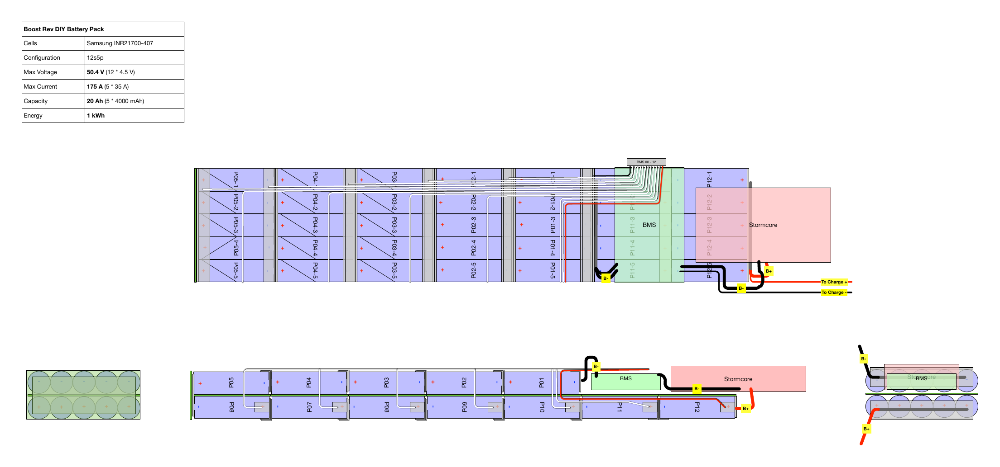

# Boosted Rev Battery Pack and VESC Conversion

A DIY 12S5P, 864 Wh battery pack and VESC motor controller for a Boosted Rev scooter.
The pack more than doubles the stock 370 Wh battery, for a theoretical range of about 55 km.



## At a glance

| Part | Choice |
|---|---|
| Cells | 60 × Samsung INR21700-40T, 12S5P |
| Pack | 50.4 V max, 43.2 V nominal, 20 Ah, 864 Wh |
| BMS | JBD 12S Smart BMS |
| Controller | Trampa VESC HD60T, dual, CAN IDs 22 and 23 |
| Previous controller | Stormcore 60D+, 2021–2026 |
| Motors | 2 × 750 W hub motors |

## Documentation

- [Battery pack](docs/battery.md): cells, pack specs, layout, build steps, nickel strip, BMS and charging.
- [Motor controller](docs/controller.md): VESC hardware, CAN layout, config files, open issues and how to change settings.
- [Maintenance](docs/maintenance.md): schedule, thresholds and procedures.
- [Tools and equipment](docs/tools.md): spot welder, charger and software.

## Logs

- [Controller log](log/controller.md): hardware record, config history, motor detection history and faults.
- [Maintenance log](log/maintenance.md): work done and battery health readings.

## Repository layout

```
docs/         how the pack and controller are built and maintained
log/          dated records: controller changes, maintenance, battery health
vesc/         VESC Tool XML exports, one directory per controller hardware
  hd60t/        current: id22-motor.xml, id22-app.xml, id23-motor.xml, id23-app.xml
  stormcore-60d/  previous controller, kept for reference
scripts/      vesc_check.py summarises, diffs and checks VESC configs
diagrams/     pack layout (OmniGraffle source, PDF and PNG)
datasheets/   cell, BMS, sealant and wire specifications
manuals/      controller, BMS, charger and power supply manuals
images/       photos
```

## Checking a VESC config

```
python3 scripts/vesc_check.py summary vesc/hd60t
python3 scripts/vesc_check.py check vesc/hd60t
python3 scripts/vesc_check.py diff vesc/stormcore-60d/id22-motor.xml vesc/hd60t/id22-motor.xml
```

The check compares the configs against the pack and BMS limits. It needs only Python 3.

## Sources and inspiration

- https://michael-castiau.blogspot.com
- https://forum.freesk8.org/t/mod-a-boosted-rev-battery-esc-and-more/942
- https://www.electricbike.com/introduction-battery-design-2/
- https://www.eboardsperu.com/product/12s4p-battery-pack-for-12s-universal-enclosure/
- https://lacroixboards.com/products/stormcore
- https://vesc-project.com/
- [MIT EV team guide to battery specifications](manuals/mit-battery-specifications-guide.pdf)

## License

[MIT](LICENSE)
