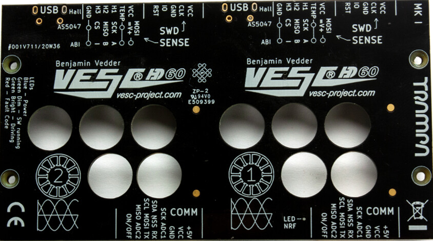

# Motor Controller (VESC)

The Rev runs two hub motors from a dual VESC controller. Both halves talk over CAN.
The live record of hardware, firmware and changes is in [log/controller.md](../log/controller.md).

## Current hardware: Trampa VESC HD60T



The HD60T is one board with two independent VESC controllers, linked internally by CAN.
See the [HD60T manual](../manuals/vesc-hd60t-manual.pdf).

| Property | Value |
|---|---|
| Input voltage | 11–52 V, about 4–12S Li-ion |
| Controllers | 2, labelled 1 and 2 on the board |
| Ports on controller 1 | USB, COMM (ADC, UART, I²C), PPM, CAN, SWD, sensor |
| Ports on controller 2 | USB, SWD, sensor. COMM, PPM and CAN stay unconnected on standard setups |
| Default MOSFET cut-off | 80 °C start, 100 °C end |
| Default motor cut-off | 80 °C start, 100 °C end |

A full 12S pack sits at 50.4 V, only 1.6 V under the 52 V rating.
Regenerative braking on a full pack pushes the voltage up, so ride gently for the first minutes after a full charge.

The manual's minimum system requirements:

1. A safety cut-off switch.
2. A fuse rated for the weakest part of the system.
3. A compatible input device.
4. Safe settings that match the battery and motors.
5. A BMS when regenerative braking is used.
6. A pre-charge or anti-spark connection. Never power the board without one.

## CAN layout

| CAN ID | Role | App | Notes |
|---|---|---|---|
| 22 | Master | ADC + UART | Reads the throttle on ADC and forwards commands to ID 23 over CAN |
| 23 | Slave | UART | Follows ID 22 through multi-ESC CAN control |

Both controllers use CAN baud rate setting 2 and send status at 50 Hz.

## Config files

VESC Tool exports live in [`vesc/`](../vesc), one directory per controller hardware.
Each file is named `id<CAN ID>-<motor|app>.xml`.

| Directory | Hardware | Status | Old file names |
|---|---|---|---|
| [`vesc/hd60t/`](../vesc/hd60t) | Trampa VESC HD60T | Current | `rev-vesc-22-*-conf.xml` → `id22-*`, `rev-vesc-local-*-conf.xml` → `id23-*` |
| [`vesc/stormcore-60d/`](../vesc/stormcore-60d) | Stormcore 60D+ | Previous | `rev-vesc-22-local-*-conf.xml` → `id22-*`, `rev-vesc-23-can-*-conf.xml` → `id23-*` |

The HD60T files use the newer VESC Tool format with `ConfigVersion` 2.
The Stormcore files use the older format.

### Key settings, HD60T

Generated with `python3 scripts/vesc_check.py summary vesc/hd60t`.

| Setting | ID 22 | ID 23 |
|---|---|---|
| App to use | 5 (ADC + UART) | 3 (UART) |
| Motor current max (A) | 60 | 60 |
| Motor current brake (A) | -60 | -60 |
| Battery current max (A) | 30 | 30 |
| Battery current regen (A) | -15 | -15 |
| Absolute current max (A) | 120 | 120 |
| Max ERPM | 21000 | 21000 |
| Battery cutoff start (V) | 34.5 | 34.5 |
| Battery cutoff end (V) | 33.5 | 33.5 |
| MOSFET temp start / end (°C) | 60 / 70 | 60 / 70 |
| Motor temp start / end (°C) | 80 / 100 | 80 / 100 |
| Motor resistance (Ω) | 0.0314 | 0.0485 |
| Motor inductance (H) | 6.769e-05 | 8.378e-05 |
| Flux linkage (Wb) | 0.010502 | 0.010487 |
| Motor poles | 14 | 40 |
| Gear ratio | 3 | 1 |
| Wheel diameter (m) | 0.083 | 0.222 |
| Battery capacity (Ah) | 6 | 20 |

### Open issues in the current config

`python3 scripts/vesc_check.py check vesc/hd60t` reports these:

- **ID 22 setup info is at VESC defaults.** Poles, gear ratio, wheel diameter and battery Ah should be 40, 1, 0.222 m and 20 Ah like ID 23. These values only affect speed, distance and battery % shown in VESC Tool, not motor control.
- **Regen equals the pack's charge limit.** 2 × 15 A is the full 30 A the cells accept. Keep it there or lower, never higher.
- **The VESC cut-off may come after the BMS cut-off.** 33.5 V is 2.79 V per cell. The BMS trips at 2.7 ± 0.1 V per cell, so a BMS at the top of its tolerance can cut power first. Raising the cut-off end to about 34.0 V removes the overlap.
- **The motor on ID 23 measures about 50 % more resistance than ID 22.** The Stormcore measured the same gap in 2021, so it most likely follows the motor or its wiring rather than the controller. Track it in the detection history and check the phase connectors if the gap grows.

## Changing the configuration

1. Connect VESC Tool over USB to controller 1 (ID 22). ID 23 is reachable over CAN.
2. Read the current motor and app configs from both controllers.
3. Make the change and write it to both controllers when it should apply to both.
4. Export all four XML files and overwrite the files in `vesc/hd60t/`, keeping the `id<NN>-<motor|app>.xml` names.
5. Run the checker and review the diff:

   ```
   python3 scripts/vesc_check.py check vesc/hd60t
   git diff --stat vesc/
   python3 scripts/vesc_check.py diff <(git show HEAD:vesc/hd60t/id22-motor.xml) vesc/hd60t/id22-motor.xml
   ```

6. Add a line to the config history in [log/controller.md](../log/controller.md#config-history). After a motor detection, also add a line to the detection history.
7. Commit with a message that says what changed and why.

## Previous hardware: Stormcore 60D+

Used from 2021 until the HD60T swap in 2026. Its configs are kept in `vesc/stormcore-60d/` for reference.
A [Stormcore 100D pinout](../manuals/stormcore-100d-pinout.pdf) is kept because it shares the connector layout.

| Property | Value |
|---|---|
| Battery input | up to 50.4 V |
| Battery current | 80 A for a couple of minutes, 100 A peak for seconds |
| Battery current used | 30 A per controller, 60 A combined |
